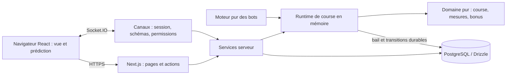
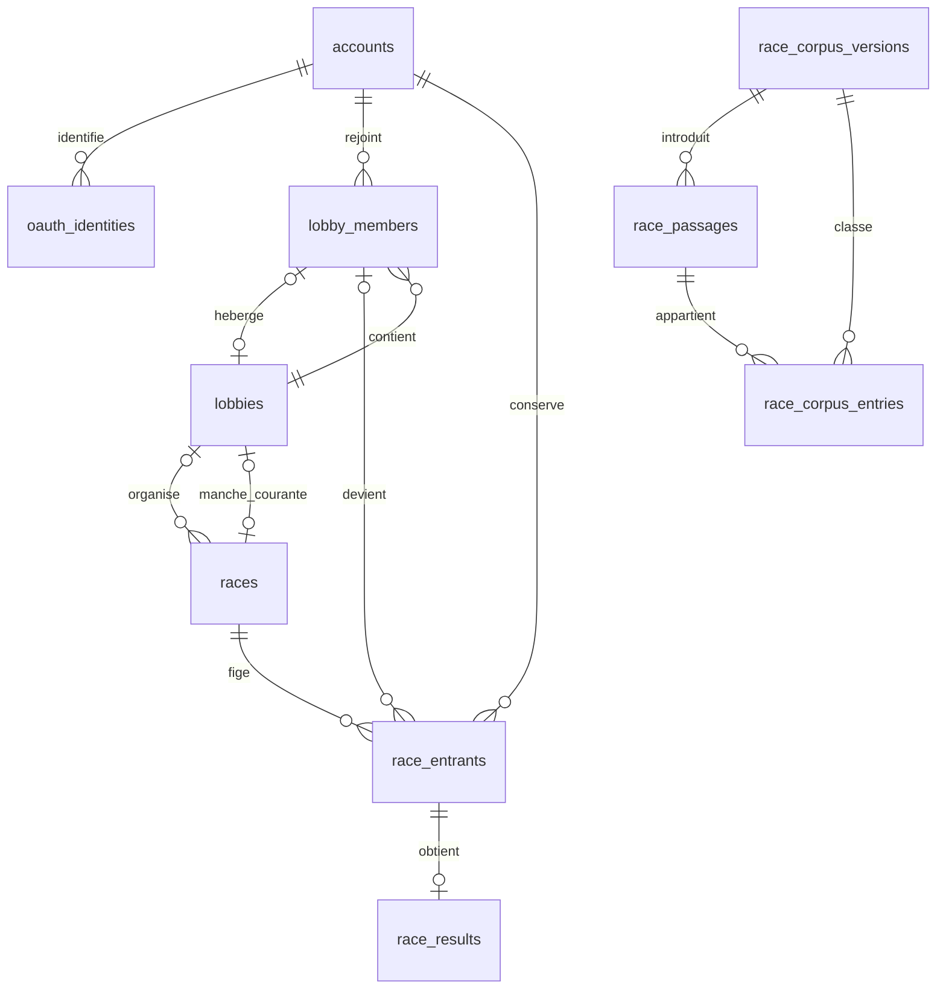
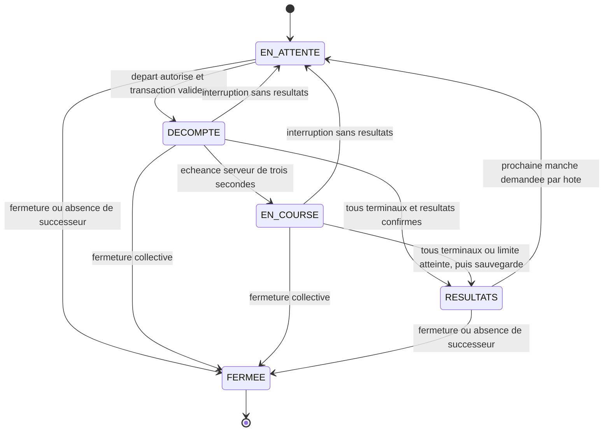
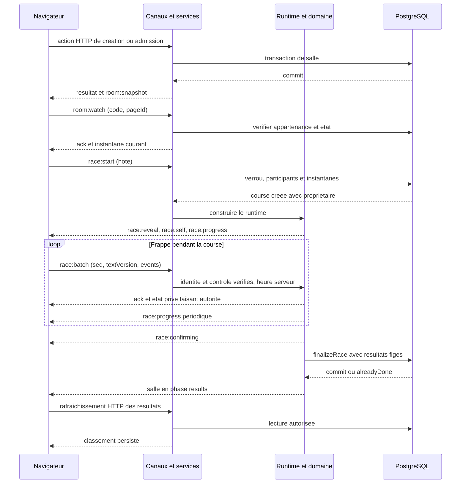

# Architecture — Incision

État du code fusionné dans `dev` au **5 novembre 2026**, référence **`c588a272`**. Cette version répond au point 4 de la [section 8 de l'énoncé final](Web-V-Travail-de-session.pdf) : modèle de données, machine à états, messages temps réel et ADR temps réel/bots. Elle remplace la description initiale du checkpoint. Je décris le code livré dans le dépôt, sans en déduire qu'il est déployé ou validé en production.

## 1. Périmètre et décisions

L'[énoncé final](Web-V-Travail-de-session.pdf) et les choix de ma [matrice](EXIGENCES.md) priment sur les anciens exemples du [cahier des charges](cahier-des-charges-incision.pdf) et du [design](../apps/design/README.md). La matrice reste le suivi des 90 exigences; cette architecture n'en change aucun statut.

| À cette référence | État vérifié dans le code |
|---|---|
| Comptes et salles | Comptes locaux et fournisseurs OAuth; invités éphémères, salles publiques/CODE/privées, invitations, bannissement, explorateur, Quickplay et succession d'hôte. Les fournisseurs réels ne sont pas retestés dans la qualification cloud. |
| Course | Décompte 3-2-1, prédiction de saisie puis validation serveur, reprise et résultats. Participants humains ou bots, spectateurs exclus du classement. |
| Configuration | Réglages D-19 sauvegardés en salle et figés au départ : langue, type, longueur, complexité, correction, durée et Arcade. Aucune limite de durée par défaut; limite optionnelle de 30 à 600 secondes. |
| Corpus | Corpus versionné lu en base; absence refusée par `TEXTS_UNAVAILABLE`, incompatibilité par `NO_COMPATIBLE_PASSAGE`. Les textes courts de fixtures sont réservés aux tests locaux. |
| Bots et bonus | Bots intégrés au runtime et aux salles; Arcade activable par l'hôte, désactivé par défaut. |
| Résultats | Historique, statistiques, records par catégorie, séries MPM et erreurs par touche privées. Journal des bonus reçus et activés, atomique avec les résultats; anciennes courses sans collecte explicitement signalées. |
| Interface | Piste animée, liste accessible, FR/EN, thèmes Aube/Abysse et présentation responsive. Les preuves automatisées et humaines restent distinguées dans la matrice. |

Sources : [service de course](../apps/web/src/server/races/race-service.ts), [réglages](../apps/web/src/server/rooms/room-settings.ts), [schéma](../packages/database/src/schema/index.ts). Le [rapport de qualification](evidence/qualification-2026-11-06/README.md) actualise les preuves locales; il ne certifie pas la production.

## 2. Un processus, trois responsabilités

[server.ts](../apps/web/server.ts) compose Next.js et Socket.IO sur le même serveur HTTP Node. Je conserve un seul processus actif pour l'état de présence et les courses, derrière le frontal HTTPS prévu par l'[ADR hébergement](adr/0002-hosting.md). Les baux SQL protègent les courses lors d'un chevauchement de processus; ils ne constituent pas un service de jeu distribué.

- [apps/web](../apps/web) contient les pages, les contrats Zod partagés avec le navigateur, les adaptateurs et les services. Le paquet `packages/contracts` de la conception initiale n'existe pas : les protocoles vivent dans `src/rooms` et `src/races`.
- [packages/domain](../packages/domain/src) contient les fonctions pures : texte, graphèmes, mesures, course, classements, bots et bonus. L'horloge et l'aléatoire y sont des entrées; le domaine n'appelle ni React, ni SQL, ni Socket.IO.
- [packages/database](../packages/database/src) contient le schéma Drizzle, les transactions, les lecteurs et l'import du corpus. Les migrations sont [versionnées](../packages/database/drizzle).
- Le navigateur conserve une prédiction de la frappe dans [RaceClient](../apps/web/src/races/race-client.ts), mais le serveur décide des positions, fautes, temps, bonus et résultats.

Les [ADR temps réel](adr/0001-realtime.md), [authentification](adr/0003-authentication.md), [propriété d'une course](adr/0004-race-ownership-lease.md) et [bots](adr/0005-deterministic-bots.md) donnent les raisons et limites de ces choix.

## 3. Modèle de données livré

Ce diagramme représente les tables exportées par le [schéma](../packages/database/src/schema/index.ts), pas les futures fonctionnalités.

| Tables | Rôle et invariants |
|---|---|
| [accounts / oauth_identities](../packages/database/src/schema/identity.ts) | Identité applicative distincte de l'identité fournisseur; aucun courriel ni jeton fournisseur conservé. Le compte local a un identifiant canonique unique et un mot de passe haché avec scrypt. `session_version` permet la révocation. |
| [lobbies / lobby_members](../packages/database/src/schema/rooms.ts) | Code unique de six caractères, capacité bornée de 2 à 30, phase et révision. Un compte ne peut être actif que dans une salle. Le membre garde un nom figé et sa date de départ. La clé étrangère composite impose que l'hôte appartienne à sa salle. La présence en ligne est en mémoire, pas une colonne SQL. |
| [races](../packages/database/src/schema/races.ts) | Numéro de manche, texte exact et configuration figés, version des règles, temps et éventuelle interruption. `owner_id`, `owner_epoch` et `lease_expires_at` protègent les transitions du processus propriétaire. La manche courante d'une salle doit appartenir à cette salle. |
| [race_entrants / race_results](../packages/database/src/schema/races.ts) | Concurrent distinct du membre de salle, lié à son type (compte, invité ou bot) et au nom du départ. Résultat unique par course/concurrent, rang unique par course, compteurs et mesures produits par le moteur. Le lien au membre peut devenir nul lors d'une purge; le compte est nullable pour les invités et les bots; aucun faux compte de bot n’est créé. |
| [race_corpus_versions / race_passages / race_corpus_entries](../packages/database/src/schema/corpus.ts) | Version et empreinte, identité et provenance du passage, puis classification/mesures propres à chaque version. Au plus une version active. L'import conserve les anciennes données au lieu de les réécrire. |

`text_snapshot` et `config_snapshot` conservent le contenu exact, la version du corpus et les réglages de la manche; ils ne dépendent pas du corpus actif lors d'une lecture ultérieure.

Le schéma livré comprend aussi `guest_sessions`, `lobby_settings`, `lobby_bots`, `lobby_invitations`, `lobby_bans`, `profile_photos`, `race_wpm_series` et `race_key_errors`. Les invités n'ont pas de compte permanent : leur identité temporaire et leurs droits expirent; leurs résultats consultables par eux restent éphémères. Les données privées ne deviennent pas publiques parce qu'un membre a observé la course. Les bots sont exclus des agrégats de profil humains. Les records séparent les catégories de correction et de bonus.

L'activité invitée acceptée est regroupée en mémoire puis persistée à intervalles de 60 secondes, avec expiration 24 heures après l'activité acceptée. Une panne peut perdre un checkpoint : après redémarrage, l'échéance SQL fait autorité. Voir les limites et la procédure d'activation dans [SETUP.md](SETUP.md).

Les transactions et lecteurs sont dans [lifecycle.ts](../packages/database/src/races/lifecycle.ts) et [results.ts](../packages/database/src/races/results.ts). Le [journal final des bonus](adr/0008-final-bonus-journals.md) est projeté exclusivement depuis les attributions et reçus serveur, puis écrit dans `race_results.bonus_journal` avec les résultats. Les cibles utilisent les ordinaux de cette course; aucune identité d’invité n’y est conservée. Les courses sans compte gardent leur journal uniquement dans les résultats temporaires en mémoire.

## 4. États : salle, moteur et persistance

Les cinq états de salle correspondent à COURSE-01. Je les sépare des états internes de la course : une interruption ne devient pas un classement.

Le [domaine](../packages/domain/src/race/reduce.ts) passe de `countdown` à `racing`, puis `ended` ou `interrupted`. Le stockage distingue `countdown`, `racing`, `finished` et `interrupted`. Entre `ended` en mémoire et `finished` confirmé en base, le [runtime](../apps/web/src/server/races/race-runtime.ts) reste en sauvegarde : `race:confirming` ne prétend pas que les résultats sont déjà durables.

Le départ exige au moins deux participants dont un humain; les spectateurs sont exclus. Le service crée les concurrents humains et les bots configurés; une salle de bots seuls ne démarre pas. Le départ, la clôture, le retour à l'attente et les admissions utilisent les transactions sous verrou de salle. Au départ de l’hôte, le plus ancien humain connecté admissible lui succède (invité ou spectateur inclus); sans successeur, la salle ferme. Une absence de socket bénéficie de la grâce de 30 secondes. Il ne s’agit pas d’un TTL arbitraire de salle.

Les échéances du domaine s'appliquent avant et après chaque événement : un minuteur retardé ne repousse pas artificiellement une arrivée ou une fin de course. Chaque concurrent termine par `finished`, `timedOut` ou `abandoned`. La reprise est permise jusqu'à 30 secondes après la perte détectée par le serveur; au-delà, l'abandon pour déconnexion s'applique. L'inactivité est signalée à 60 secondes et devient un abandon au-delà de 120 secondes sans activité (D-17). Les limites exactes et leur ordre sont documentés dans [types.ts](../packages/domain/src/race/types.ts) et testés dans le domaine.

Un seul onglet contrôle la saisie; les autres observent et peuvent demander le contrôle. La grâce de transfert d'onglet est de trois secondes, distincte de la reprise réseau. Le battement Socket.IO est de dix secondes avec cinq secondes d'attente : une coupure silencieuse peut donc être détectée jusqu'à environ quinze secondes après le dernier échange. Les trente secondes commencent à cette détection.

## 5. Messages et autorité

Les actions HTTP de salle et le canal Socket.IO partagent les services; je ne présente pas la création, l'admission ou la fermeture comme des commandes WebSocket fictives.

| Message | Utilisation livrée |
|---|---|
| `room:watch` / `room:snapshot` | Abonnement autorisé à la salle et projection révisée de ses membres/présences. |
| `system:ping` | Réponse avec heure serveur. Le [client d'horloge](../apps/web/src/races/clock-sync.ts) estime le demi-aller-retour, retient le meilleur échantillon récent et avance avec une horloge monotone. L'asymétrie réseau reste une limite d'affichage, jamais une autorisation de frappe. |
| `race:start` / `race:reveal` | Départ demandé par l'hôte; texte révélé dès le début du décompte, jamais dans la salle d'attente. |
| `race:batch` / `race:self` | Lots séquencés et versionnés; correction de la prédiction et mesures privées. Le concurrent vient de la session, pas du contenu fourni par le navigateur. |
| `race:progress` | Projection publique; diffusion périodique au plus quatre fois par seconde (intervalle minimal de 250 ms), pouvant être volatile. Un nouvel abonnement reçoit un instantané direct. |
| `race:control`, `race:present`, `race:abandon` | Contrôle d'onglet, réponse à l'inactivité et abandon confirmé. |
| `race:confirming` | Résultats figés en mémoire, en attente de confirmation SQL. Il n'existe pas de message `race:results` dans ce protocole. |
| `race:bonus:activate`, `race:bonus:self`, `race:bonus:announcement` | Activation, inventaire privé et annonces publiques. Le [protocole bonus](../apps/web/src/races/bonus-protocol.ts) est livré; les salles ordinaires l’activent lorsque leur réglage Arcade le demande. |

Les sources sont les protocoles [salle](../apps/web/src/rooms/protocol.ts) et [course](../apps/web/src/races/protocol.ts), le [canal course](../apps/web/src/server/realtime/race-channel.ts) et le [runtime](../apps/web/src/server/races/race-runtime.ts). La version du texte interdit qu'un lot ancien traverse silencieusement un changement de cible. Le domaine limite notamment les lots à 64 événements et dix lots par seconde; le navigateur conserve un seul lot en vol. Une réponse perdue peut mener à la retransmission du même lot, sans doubler la progression.

Socket.IO assure l'ordre des événements reçus, pas une sauvegarde durable de chaque message. Je m'appuie sur les séquences, révisions et instantanés applicatifs, comme expliqué dans l'[ADR temps réel](adr/0001-realtime.md), plutôt que sur une garantie de livraison que le transport ne fournit pas.

## 6. Sauvegarde, pannes et sécurité

Je ne fais pas de requête SQL par touche. Le runtime garde l'état de la course et gèle les résultats une fois la manche terminée. [finalizeRace](../packages/database/src/races/lifecycle.ts) écrit les résultats et change les phases dans une transaction idempotente, protégée par le propriétaire et sa génération. Une réponse perdue après commit peut être reconnue par `alreadyDone`; elle ne provoque ni résultat doublé ni fausse interruption.

Le bail est renouvelé toutes les dix secondes pour trente secondes. Sans confirmation à temps, le runtime suspend localement la saisie et les diffusions avant l'expiration présumée; si un autre processus récupère la course, l'ancien propriétaire ne peut plus écrire. Les détails des marges, tentatives et délais de fermeture sont dans l'[ADR-0004](adr/0004-race-ownership-lease.md). Un crash mène à une interruption sans résultats après expiration et récupération, pas à la reconstruction de toutes les frappes. Une fermeture collective interrompt également la manche active.

Les cookies Auth.js donnent l'identité, vérifiée à l'ouverture du socket. Le registre suit expiration et révocation; les canaux vérifient la session, l'appartenance et les permissions nécessaires à chaque action. Les schémas Zod bornent les données non fiables, les limiteurs bornent les requêtes et l'[origine](../apps/web/src/server/realtime/origin.ts) du handshake est contrôlée. Un `Origin` absent reste permis pour le polling même origine ou un client non navigateur : l'authentification reste nécessaire aux actions privées.

La lecture de `/races/[id]` est réservée à un compte concurrent; la vue de résultats dans une salle suit les droits de ses membres. Je ne publie ni état privé des autres joueurs ni graine de bot. Le pool SQL et les transactions bornées sont livrés et testés localement; leur vérification via le pooler Neon reste une action séparée, non réalisée par cette révision documentaire.

## 7. Bots et bonus : limites de l'intégration

L'[ADR-0005](adr/0005-deterministic-bots.md) décrit le moteur livré : cinq profils, état pseudo-aléatoire versionné, horloge injectée, une intention par échéance, puis application par le même réducteur que pour les humains. Un retard serveur ralentit le bot; il ne crée pas une rafale de rattrapage ni un résultat rétroactif.

Le [coordinateur bonus](../packages/domain/src/bonuses/coordinator.ts) fait évoluer la course et les attributions/effets dans un même état. Le runtime publie ensuite les changements privés et annonces. Le navigateur gère Entrée et les effets visuels; le serveur reste l'autorité sur la cible et sa version. Le réglage Arcade et les bots sont raccordés au service. Leur intégration est couverte par les tests du runtime, SQL et E2E; l'acceptation éditoriale des contenus et la recette humaine restent distinctes. Le journal final est désormais enregistré avec les résultats (ADR-0008), à partir des seuls faits serveur; les tests d’intégration suivent aussi une course Arcade jusqu’à cette écriture. Les tentatives refusées et expirations d’effets ne sont pas un journal de rejeu.

## 8. Vérification et évolution

La CI existante vérifie TypeScript, lint, règles pures, schéma/migrations, PostgreSQL, build, archive de livraison, processus serveur et parcours navigateur. La présence de ces contrôles ne suffit pas à déclarer une fonctionnalité non raccordée terminée. Les [tests du runtime](../apps/web/src/server/races/race-runtime.test.ts), les [tests SQL des courses](../packages/database/test/races.db.test.ts) et l'[intégration multiprocessus](../apps/web/integration/race.integration.test.ts) sont les preuves associées aux frontières décrites ici.

Les preuves de la révision architecturale du 25 octobre restent conservées dans leur [note historique](evidence/f10-2-architecture/README.md). Cette actualisation corrige les écarts entre cette description et le code du 5 novembre, sans changer les règles produit ni réattribuer les preuves historiques.

Le nom, le logo et les fichiers de [direction artistique](../apps/design/README.md) restent inchangés. Toute évolution multi-instance exige un partage explicite des états métier, pas seulement un adaptateur Socket.IO.
