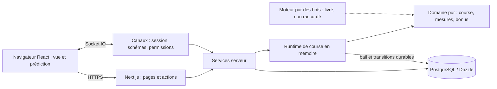
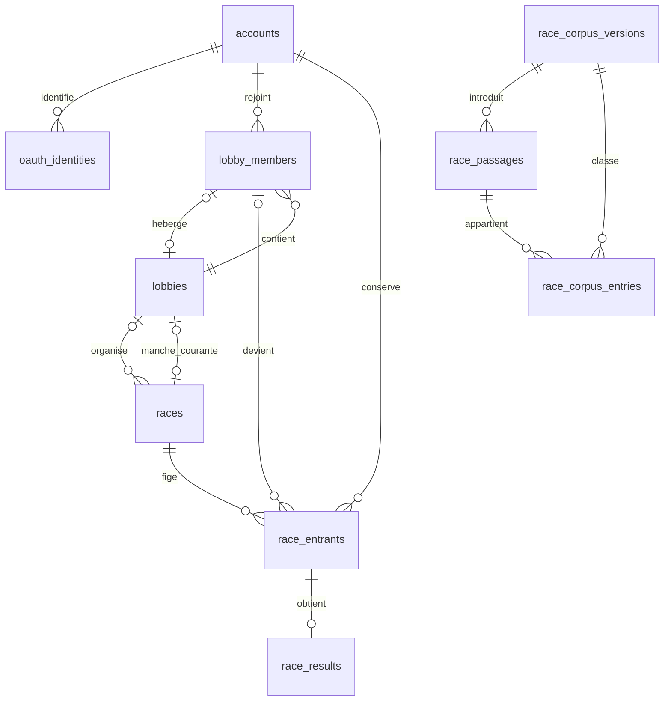
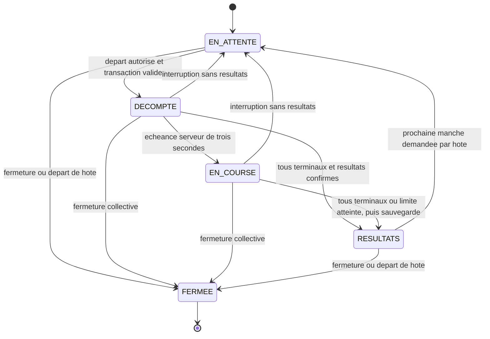
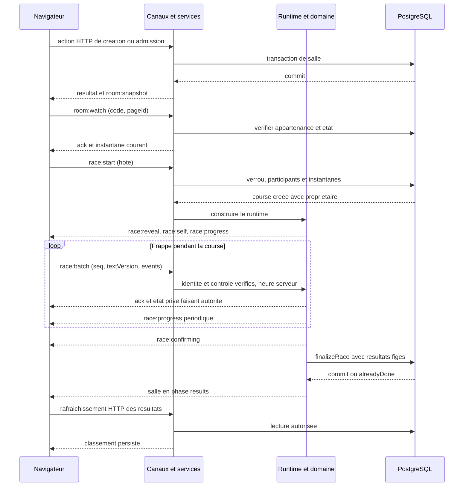

# Architecture — Incision

État du code fusionné dans `dev` au **25 octobre 2026**, référence **`f4600af`**. Cette version répond au point 4 de la [section 8 de l'énoncé final](Web-V-Travail-de-session.pdf) : modèle de données, machine à états, messages temps réel et ADR temps réel/bots. Elle remplace la description initiale du checkpoint. Je décris le code livré dans le dépôt, sans en déduire qu'il est déployé ou validé en production.

## 1. Périmètre et décisions

L'[énoncé final](Web-V-Travail-de-session.pdf) et les choix de ma [matrice](EXIGENCES.md) priment sur les anciens exemples du [cahier des charges](cahier-des-charges-incision.pdf) et du [design](../apps/design/README.md). La matrice reste le suivi des 90 exigences; cette architecture n'en change aucun statut.

| À cette référence | État vérifié dans le code |
|---|---|
| Comptes et salles | GitHub, Discord et comptes locaux; création/admission par code, présence, contrôle de l'hôte et fermeture confirmée. Les membres persistés sont des comptes authentifiés. |
| Course humaine | Décompte 3-2-1, révélation au début du décompte, saisie prédite puis validée par le serveur, mesures, abandon, reprise et résultats persistés. |
| Configuration réellement utilisée | Deux passages fixes, FR/EN selon la langue de l'hôte au départ; correction obligatoire, limite de deux minutes, `bonuses: false`. Le service ne réalise pas encore tous les réglages de D-19. |
| Corpus | Tables et import versionné livrés. La sélection serveur du corpus et ses données en préparation ne remplacent pas encore les deux passages fixes de cette référence. |
| Bots | Moteur déterministe livré. L'admission, le pilotage serveur et les bots jouables dans les salles restent à intégrer en F-05.2. |
| Bonus | Règles pures, coordination atomique, adaptateur serveur et interface livrés; les salles ordinaires gardent les bonus désactivés. Cela ne qualifie pas encore Arcade de bout en bout. |
| Résultats | Tableau et fiche de course accessibles aux ayants droit; pas encore de séries MPM, graphiques, statistiques de profil ou journal de bonus persisté. |
| Interface | Piste simple en liste. La piste verticale finale reste F-04.5. À cette référence, les PR #140 (mobile) et #141 (historique paginé) sont en revue et ne font pas partie du code décrit. |

Les réglages constatés se trouvent dans [race-service.ts](../apps/web/src/server/races/race-service.ts) et les passages dans [race-texts.ts](../apps/web/src/server/races/race-texts.ts). Je distingue ces adaptations transitoires des objectifs D-17/D-19, dont l'absence de limite de temps par défaut. Le détail des preuves de cette révision est dans la [note de vérification F-10.2](evidence/f10-2-architecture/README.md).

## 2. Un processus, trois responsabilités

[server.ts](../apps/web/server.ts) compose Next.js et Socket.IO sur le même serveur HTTP Node. Je conserve un seul processus actif pour l'état de présence et les courses, derrière le frontal HTTPS prévu par l'[ADR hébergement](adr/0002-hosting.md). Les baux SQL protègent les courses lors d'un chevauchement de processus; ils ne constituent pas un service de jeu distribué.

- [apps/web](../apps/web) contient les pages, les contrats Zod partagés avec le navigateur, les adaptateurs et les services. Le paquet `packages/contracts` de la conception initiale n'existe pas : les protocoles vivent dans `src/rooms` et `src/races`.
- [packages/domain](../packages/domain/src) contient les fonctions pures : texte, graphèmes, mesures, course, classements, bots et bonus. L'horloge et l'aléatoire y sont des entrées; le domaine n'appelle ni React, ni SQL, ni Socket.IO.
- [packages/database](../packages/database/src) contient le schéma Drizzle, les transactions, les lecteurs et l'import du corpus. Les migrations sont [versionnées](../packages/database/drizzle).
- Le navigateur conserve une prédiction de la frappe dans [RaceClient](../apps/web/src/races/race-client.ts), mais le serveur décide des positions, fautes, temps, bonus et résultats.

Les [ADR temps réel](adr/0001-realtime.md), [authentification](adr/0003-authentication.md), [propriété d'une course](adr/0004-race-ownership-lease.md) et [bots](adr/0005-deterministic-bots.md) donnent les raisons et limites de ces choix.

## 3. Modèle de données livré

Ce diagramme représente les tables exportées par le [schéma](../packages/database/src/schema/index.ts), pas les futures fonctionnalités.

| Tables | Rôle et invariants |
|---|---|
| [accounts / oauth_identities](../packages/database/src/schema/identity.ts) | Identité applicative distincte de l'identité fournisseur; aucun courriel ni jeton fournisseur conservé. Le compte local a un identifiant canonique unique et un mot de passe haché avec scrypt. `session_version` permet la révocation. |
| [lobbies / lobby_members](../packages/database/src/schema/rooms.ts) | Code unique de six caractères, capacité bornée de 2 à 30, phase et révision. Un compte ne peut être actif que dans une salle. Le membre garde un nom figé et sa date de départ. La clé étrangère composite impose que l'hôte appartienne à sa salle. La présence en ligne est en mémoire, pas une colonne SQL. |
| [races](../packages/database/src/schema/races.ts) | Numéro de manche, texte exact et configuration figés, version des règles, temps et éventuelle interruption. `owner_id`, `owner_epoch` et `lease_expires_at` protègent les transitions du processus propriétaire. La manche courante d'une salle doit appartenir à cette salle. |
| [race_entrants / race_results](../packages/database/src/schema/races.ts) | Concurrent distinct du membre de salle, lié au compte et au nom du départ. Résultat unique par course/concurrent, rang unique par course, compteurs et mesures produits par le moteur. Le lien au membre peut devenir nul lors d'une purge; le lien au compte reste obligatoire. |
| [race_corpus_versions / race_passages / race_corpus_entries](../packages/database/src/schema/corpus.ts) | Version et empreinte, identité et provenance du passage, puis classification/mesures propres à chaque version. Au plus une version active. L'import conserve les anciennes données au lieu de les réécrire. |

Le corpus n'a pas encore de clé étrangère depuis `races` à cette référence. `text_snapshot` et `config_snapshot` conservent le contenu utilisé par le service actuel. Un enum SQL de visibilité ne signifie pas que l'explorateur public, les invitations ou toute la configuration soient disponibles.

`guest_sessions`, `lobby_settings`, `lobby_invitations`, `lobby_bans`, les séries MPM, erreurs par touche et événements de bonus ne sont **pas** des tables livrées. Je les garde dans le périmètre des cartes restantes, sans les dessiner comme présentes. Les transactions et les lecteurs de résultats sont dans [lifecycle.ts](../packages/database/src/races/lifecycle.ts) et [results.ts](../packages/database/src/races/results.ts); le [document de données](architecture/data-model.md) complète les règles de conservation.

## 4. États : salle, moteur et persistance

Les cinq états de salle correspondent à COURSE-01. Je les sépare des états internes de la course : une interruption ne devient pas un classement.

Le [domaine](../packages/domain/src/race/reduce.ts) passe de `countdown` à `racing`, puis `ended` ou `interrupted`. Le stockage distingue `countdown`, `racing`, `finished` et `interrupted`. Entre `ended` en mémoire et `finished` confirmé en base, le [runtime](../apps/web/src/server/races/race-runtime.ts) reste en sauvegarde : `race:confirming` ne prétend pas que les résultats sont déjà durables.

Le départ exige au moins deux participants dont un humain; les spectateurs sont exclus. Le domaine sait représenter les bots, mais le service actuel ne crée que des concurrents issus de comptes. Le départ, la clôture, le retour à l'attente et les admissions utilisent les transactions sous verrou de salle.

Les échéances du domaine s'appliquent avant et après chaque événement : un minuteur retardé ne repousse pas artificiellement une arrivée ou une fin de course. Chaque concurrent termine par `finished`, `timedOut` ou `abandoned`. La reprise est permise jusqu'à 30 secondes après la perte détectée par le serveur; au-delà, l'abandon pour déconnexion s'applique. L'inactivité est signalée à 60 secondes et devient un abandon au-delà de 120 secondes sans activité (D-17). Les limites exactes et leur ordre sont documentés dans [types.ts](../packages/domain/src/race/types.ts) et testés dans le domaine.

Un seul onglet contrôle la saisie; les autres observent et peuvent demander le contrôle. La grâce de transfert d'onglet est de trois secondes, distincte de la reprise réseau. Le battement Socket.IO est de dix secondes avec cinq secondes d'attente : une coupure silencieuse peut donc être détectée jusqu'à environ quinze secondes après le dernier échange. Les trente secondes commencent à cette détection.

## 5. Messages et autorité

Les actions HTTP de salle et le canal Socket.IO partagent les services; je ne présente pas la création, l'admission ou la fermeture comme des commandes WebSocket fictives.

| Message | Utilisation livrée |
|---|---|
| `room:watch` / `room:snapshot` | Abonnement autorisé à la salle et projection révisée de ses membres/présences. |
| `system:ping` | Réponse avec heure serveur. Le [client d'horloge](../apps/web/src/races/clock-sync.ts) estime le demi-aller-retour, retient le meilleur échantillon récent et avance avec une horloge monotone. L'asymétrie réseau reste une limite d'affichage, jamais une autorisation de frappe. |
| `race:start` / `race:reveal` | Départ demandé par l'hôte; texte révélé dès le début du décompte, jamais dans la salle d'attente. |
| `race:batch` / `race:self` | Lots séquencés et versionnés; correction de la prédiction et mesures privées. Le concurrent vient de la session, pas du contenu fourni par le navigateur. |
| `race:progress` | Projection publique; diffusion périodique au plus quatre fois par seconde (intervalle minimal de 250 ms), pouvant être volatile. Un nouvel abonnement reçoit un instantané direct. |
| `race:control`, `race:present`, `race:abandon` | Contrôle d'onglet, réponse à l'inactivité et abandon confirmé. |
| `race:confirming` | Résultats figés en mémoire, en attente de confirmation SQL. Il n'existe pas de message `race:results` dans ce protocole. |
| `race:bonus:activate`, `race:bonus:self`, `race:bonus:announcement` | Activation, inventaire privé et annonces publiques. Le [protocole bonus](../apps/web/src/races/bonus-protocol.ts) est livré; les salles ordinaires ne l'activent pas encore. |

Les sources sont les protocoles [salle](../apps/web/src/rooms/protocol.ts) et [course](../apps/web/src/races/protocol.ts), le [canal course](../apps/web/src/server/realtime/race-channel.ts) et le [runtime](../apps/web/src/server/races/race-runtime.ts). La version du texte interdit qu'un lot ancien traverse silencieusement un changement de cible. Le domaine limite notamment les lots à 64 événements et dix lots par seconde; le navigateur conserve un seul lot en vol. Une réponse perdue peut mener à la retransmission du même lot, sans doubler la progression.

Socket.IO assure l'ordre des événements reçus, pas une sauvegarde durable de chaque message. Je m'appuie sur les séquences, révisions et instantanés applicatifs, comme expliqué dans l'[ADR temps réel](adr/0001-realtime.md), plutôt que sur une garantie de livraison que le transport ne fournit pas.

## 6. Sauvegarde, pannes et sécurité

Je ne fais pas de requête SQL par touche. Le runtime garde l'état de la course et gèle les résultats une fois la manche terminée. [finalizeRace](../packages/database/src/races/lifecycle.ts) écrit les résultats et change les phases dans une transaction idempotente, protégée par le propriétaire et sa génération. Une réponse perdue après commit peut être reconnue par `alreadyDone`; elle ne provoque ni résultat doublé ni fausse interruption.

Le bail est renouvelé toutes les dix secondes pour trente secondes. Sans confirmation à temps, le runtime suspend localement la saisie et les diffusions avant l'expiration présumée; si un autre processus récupère la course, l'ancien propriétaire ne peut plus écrire. Les détails des marges, tentatives et délais de fermeture sont dans l'[ADR-0004](adr/0004-race-ownership-lease.md). Un crash mène à une interruption sans résultats après expiration et récupération, pas à la reconstruction de toutes les frappes. Une fermeture collective interrompt également la manche active.

Les cookies Auth.js donnent l'identité, vérifiée à l'ouverture du socket. Le registre suit expiration et révocation; les canaux vérifient la session, l'appartenance et les permissions nécessaires à chaque action. Les schémas Zod bornent les données non fiables, les limiteurs bornent les requêtes et l'[origine](../apps/web/src/server/realtime/origin.ts) du handshake est contrôlée. Un `Origin` absent reste permis pour le polling même origine ou un client non navigateur : l'authentification reste nécessaire aux actions privées.

La lecture de `/races/[id]` est réservée à un compte concurrent; la vue de résultats dans une salle suit les droits de ses membres. Je ne publie ni état privé des autres joueurs ni graine de bot. Le pool SQL et les transactions bornées sont livrés et testés localement; leur vérification via le pooler Neon reste une action séparée, non réalisée par cette révision documentaire.

## 7. Bots et bonus : limites de l'intégration

L'[ADR-0005](adr/0005-deterministic-bots.md) décrit le moteur livré : cinq profils, état pseudo-aléatoire versionné, horloge injectée, une intention par échéance, puis application par le même réducteur que pour les humains. Un retard serveur ralentit le bot; il ne crée pas une rafale de rattrapage ni un résultat rétroactif.

Le [coordinateur bonus](../packages/domain/src/bonuses/coordinator.ts) fait évoluer la course et les attributions/effets dans un même état. Le runtime publie ensuite les changements privés et annonces. Le navigateur gère Entrée et les effets visuels; le serveur reste l'autorité sur la cible et sa version. Les extensions déterministes sont disponibles dans le domaine, mais leur contenu approuvé, le réglage Arcade, la participation effective des bots et la persistance détaillée des bonus restent à intégrer ou qualifier. Je ne transforme pas des scénarios avec fixtures en preuve d'activation pour les salles ordinaires.

## 8. Vérification et évolution

La CI existante vérifie TypeScript, lint, règles pures, schéma/migrations, PostgreSQL, build, archive de livraison, processus serveur et parcours navigateur. La présence de ces contrôles ne suffit pas à déclarer une fonctionnalité non raccordée terminée. Les [tests du runtime](../apps/web/src/server/races/race-runtime.test.ts), les [tests SQL des courses](../packages/database/test/races.db.test.ts) et l'[intégration multiprocessus](../apps/web/integration/race.integration.test.ts) sont les preuves associées aux frontières décrites ici.

Pour cette carte documentaire, j'ai relu le code à la référence annoncée, le brief et les ADR, puis vérifié les liens et les diagrammes. Les tests ciblés réellement rejoués sont consignés dans la [note de vérification](evidence/f10-2-architecture/README.md). Aucun nouveau contrôle navigateur ou de production n'est attribué à ce travail.

Les futures livraisons doivent mettre à jour cette description lorsqu'elles raccordent les bots, remplacent les textes fixes, enrichissent le schéma ou ajoutent les écrans restants. Le nom, le logo et les fichiers de [direction artistique](../apps/design/README.md) restent inchangés. Toute évolution multi-instance exige un partage explicite des états métier, pas seulement un adaptateur Socket.IO.
