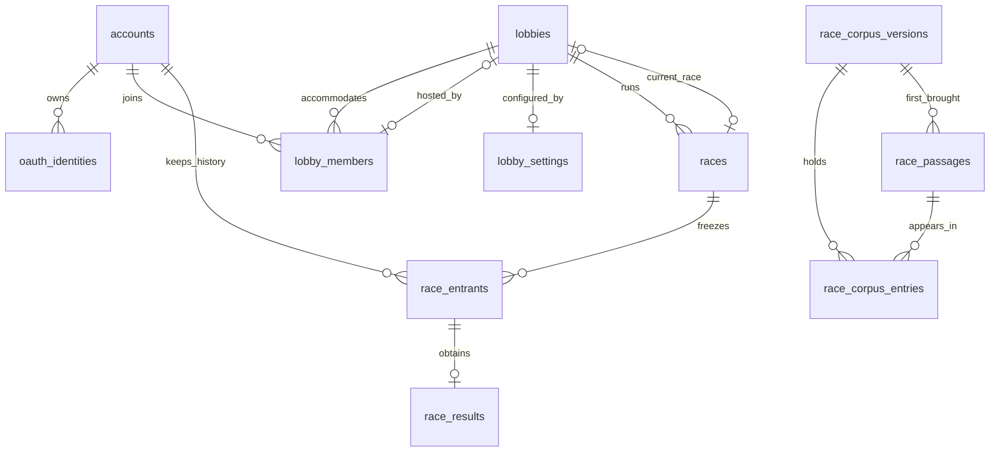

# PostgreSQL data model

Conceptual model aligned on October 2, 2026. Only the subset described in [Delivered schema](#delivered-schema) is migrated today. Source: final brief and explicit choices in [EXIGENCES.md](../EXIGENCES.md). The main diagram is in [ARCHITECTURE.md](../ARCHITECTURE.md). UUID internal identifiers, server UTC dates, versioned Drizzle migrations.

## Target tables

| Table | Key fields | Invariants |
|---|---|---|
| `accounts` | id, login?, login_canonical?, display_name, password_hash?, avatar_key?, dates | Unique local identifier, distinct from the editable nickname. OAuth account without a password allowed. No email stored, per the specification; no email-based recovery. |
| `oauth_identities` | account_id, provider, provider_subject | Unique provider + subject pair; GitHub and Discord. No automatic merging by nickname. Provider tokens are not stored if they only serve for sign-in. |
| `guest_sessions` | id, secret_digest, expires_at | Signed cookie proving a guest identity; no uploaded photo, no personal history. The nickname belongs to the presence in the room. |
| `lobbies` | id, code, visibility, capacity, host_member_id, phase, created_at, closed_at?, revision | Unique code of 6 unambiguous characters; visibility PUBLIC / CODE / PRIVATE. Capacity 2..30 participants, bots included, spectators excluded. Host is an active human of this room. |
| `lobby_settings` | lobby_id, revision, max_duration_ms?, language, text_kind, word_count, complexity, options, error_mode, bonuses_enabled, bonus_activation | One configuration per room. Timer null or 30 000..600 000 ms. Options validated by schema; version frozen at the start. Manual activation by default, automatic activation optional. |
| `lobby_members` | id, lobby_id, account_id?, guest_session_id?, bot_level?, role, display_name, display_name_canonical, joined_at, left_at? | Exactly one subject: account / guest / bot. Bot among five levels, participant role. A human is a participant or a spectator. Temporary disconnection ≠ leaving. |
| `lobby_invitations` | id, lobby_id, token_digest, bound_member_id?, bound_ip_digest?, bound_at?, revoked_at? | Random 32-byte token. The first use binds the IP and the human session; reuse by this identity/IP allowed. Revoked on kick, invalidated on closure. |
| `lobby_bans` | lobby_id, account_id? or guest_session_id?, created_at | Prevents any readmission of this identity to this room, by code, link or direct access. No global IP ban of an entire class. |
| `texts` | id, content, language, word_count, complexity, rights_reference | Real corpus in the database, verifiable provenance. Versioned/seeded dictionaries for random mode. No mandatory user text. |
| `races` | id, lobby_id, round_no, state, config_snapshot, text_snapshot, seed, rules_version, countdown_at, started_at?, ended_at?, interruption_reason? | Historical round distinct from the room; unique (lobby_id, round_no). Snapshot of the generated text even without a corpus text_id. |
| `race_entrants` | id, race_id, member_id?, account_id?, kind, name_snapshot, avatar_snapshot, target_snapshot, effective_target_chars | Identities frozen at the start, without spectators; member_id nullable after the room is purged. account_id enables the account history. Guest archived under an anonymised label without guest_session_id. |
| `race_results` | entrant_id, outcome, elapsed_ms, progress_chars, target_chars, correct_inputs, total_inputs, errors, net_mpm, gross_mpm, accuracy, rank, abandonment_reason? | One final result per entrant. Statuses FINISHED / TIMED_OUT / ABANDONED; a network timeout is a reason for abandonment, not a fourth ranking category. |
| `race_mpm_samples` | entrant_id, elapsed_ms, net_mpm, gross_mpm | Persisted time series to render the collective chart; key (entrant_id, elapsed_ms). Proposed sampling: 1 Hz + final sample. |
| `race_key_errors` | entrant_id, expected_key, error_count | Aggregates for the player's heatmap; no durable raw log of all their keystrokes. Personal access. |
| `race_bonus_events` | id, race_id, checkpoint, recipient_id, target_id?, type, granted_at, activated_at?, payload | Idempotent award per race/milestone/recipient; at most 3 bonuses per entrant. Target changes and temporary effects replayable. |

The authentication schema depends on the Auth.js prototype. With JWT sessions, an `auth_sessions` table is **not** a conceptual obligation; do not mix the two strategies. The guest cookie remains distinct and signed. No migration will be declared compliant before it has run on PostgreSQL.

## Uniqueness, identity and concurrency

- `UNIQUE(account_id) WHERE left_at IS NULL` and `UNIQUE(guest_session_id) WHERE left_at IS NULL` on members: **one active room per identity**, including as a spectator (SALLE-06). The bots' NULLs do not create collisions.
- A second tab finds the same member. A reconnection during the grace period reuses its row; after a real departure, an authorised readmission creates a new presence and therefore a new seniority.
- `UNIQUE(lobby_id, display_name_canonical) WHERE left_at IS NULL`: local disambiguation of nicknames. The account does not silently change its global nickname because of a local collision.
- Proposed canonicalisation: trim, NFKC, lowercase; accents kept. Validate length and control characters after normalisation; do not treat all visually similar scripts as equal. The guest nickname has 3..20 Unicode characters according to the documented segmentation convention.
- `UNIQUE(code)` with the alphabet `23456789ABCDEFGHJKMNPQRSTUVWXYZ`. The code is stored readable: it is not an authentication secret; protection relies on visibility, permissions and per-IP rate limiting. A PRIVATE room refuses the code.
- Capacity cannot be guaranteed by a simple cross-row CHECK: lock the room, count its active participants, then insert/change role in the same transaction.
- The host must reference a member of **the same room**, human and active. Composite constraint or transactional validation; create the room, the creator member and the host link atomically.
- Tabs are not additional participants. The uniqueness of an anonymous person who cleared their cookie or changed browser cannot be guaranteed: the scope of SALLE-06 is the proven identity.

## Invitations and IP

The invitation token is hashed in the database. The IP is normalised, then represented by an HMAC fingerprint scoped to the room; its raw value is not exposed in the invitation list. Only the headers of a known reverse proxy are trusted.

The IP alone does not prove identity: several students can share the same public IP. The link is therefore also bound to the member/session of the first use. Same IP + another cookie does not admit a second guest. An IP change is refused, in accordance with SALLE-04, even if it hinders a Wi-Fi/mobile reconnection. This constraint and the handling of a lost cookie must be explained to the user.

## Critical transactions

1. **Create / join / switch room**: identity, visibility, ban, phase and capacity checked; global uniqueness constraints. A proposed switch is confirmed before leaving the current room. The locks of two rooms are taken in a stable order.
2. **Consume an invitation**: lock invitation/room, bind IP + member only once and admit atomically; a valid repetition returns the same member.
3. **Kick / leave**: set left_at, add the ban if kicked, revoke the associated links, then select the next host or close. Broadcast after commit.
4. **Start**: authorised host, phase EN_ATTENTE, at least two participants including one present human; freeze configuration/text/entrants and start the countdown. A double click does not create two races.
5. **Finish**: idempotent finalisation of results, series, errors and bonuses; move to results in the same transaction. Repeated attempts add neither duplicate wins nor duplicate samples.

## Calculations and history

Apply Appendix A: net MPM = (correctly typed characters / 5) / minutes; gross = (typed characters / 5) / minutes; accuracy = correct / total × 100; progress = validated characters / effective target. Spaces included. Do not multiply net MPM by accuracy a second time.

The time is the server's time since the start, not only the connected time. Distinguish input counters from progress through the text. Deletion, correction, composed accents and free mode require reference tests; detailed decisions in EXIGENCES. No bonus credits keystrokes that were never made.

Ranking: FINISHED by arrival, then TIMED_OUT by progress, then ABANDONED by frozen progress. The profile and the history belong to the account; no public profile search imposed. The anonymised guest/bot snapshots do not allow viewing a personal guest history.

## Proposed retention and operations

- Guest sessions: expire after 24 h of inactivity, extended only by authenticated activity; purged after expiry and end of presence. Close/purge empty rooms, invitations/IPs and bans no later than 24 h after closure.
- Keep the anonymised snapshots useful for account results; do not keep links to the guest identity. Do not promote an old guest history when an account is created.
- For accounts, retention during the project until grading; post-grading policy to be decided before real school use. This technical choice is not a legal certification.
- Live progress in memory, no write on every keystroke. Lost connection: state kept during the grace period; result/series written at the end of the race. A process crash has no guaranteed exact recovery in this version: mark the race interrupted and do not invent its results.
- Indexes: active members, OAuth, code, public exploration (phase/visibility/dates), races per room, entrants per account/race and series per entrant/time. History pagination; grouped loading avoiding N+1.

## Data slice for checkpoint 1

Accounts, GitHub/Discord identities, guest sessions if delivered, rooms, minimal configuration and members: these elements make up the first migration. Global uniqueness, membership and capacity constraints from admission onwards, not a late fix. OAuth **is no longer postponed**.

An initial seed allows a reproducible demo with non-real local accounts. The corpus, then the demo history, are added with the game tables; TECH-04 stays partial as long as the complete seed requested does not exist. Do not create the game tables only to fill the diagram.

## Delivered schema

### F-07.1B: bounded WPM series (migration 0008)

`race_wpm_series` stores one versioned JSON value per `(race_id, entrant_id)`, referencing
the composite primary key of `race_results` with cascading deletion. This replaces the
proposed one-row-per-sample layout above for this implementation. Version 1 keeps at most
512 actual cumulative observations and their retained spacing. The collector starts at
one-second spacing and doubles it when needed; it preserves endpoints, never interpolates,
and keeps exact, unrounded net/raw WPM and counters. SQL bounds version, array length and
payload size; application validation also checks chronology, counters and exact final-result
agreement. No typed text, session identity or random seed belongs in this payload.
The spacing describes the current sampling cadence, not a uniform grid: endpoints preserved
by an earlier coarsening can remain closer than that cadence when they later become interior.

The runtime observes post-reduction state synchronously and samples silence with a separate
timer that neither reduces events nor performs SQL. An overdue engine deadline prevents
sampling until the normal transition has run. Terminal observations use the engine's terminal
elapsed time, including zero for countdown abandonment. Lease suspension never subtracts
time from WPM duration. Frozen series travel with the same immutable result array through
retries and process shutdown. `finalizeRace` inserts both tables and advances the room in the
same fenced transaction; losing/replayed writes add nothing. An interruption writes neither.

Historical results are not backfilled. The internal writer requires either a validated series
or an explicit `unavailable: "not_collected"` declaration from a non-live producer; the live
runtime always supplies a series. Readers load series only after existing entrant/active-room
access checks, in one bounded query. An absent row means no collected history, while corrupt
stored data fails validation rather than becoming an empty curve. No chart, guest support,
key-error aggregation or bonus-event history is delivered by this storage tranche.

Deployment requires additive migration 0008 before the new reader/writer is enabled. The
previous application ignores the new table and remains usable after an application rollback;
do not drop the table to roll back code. Tests apply the generated migration locally only.
No Neon migration or production deployment is implied by this section.

Migrations `0000_init` (CP-03), `0001_session_version` (CP-04), `0002_races` (F-04.0, data foundations of the first complete race), `0003_engine_error` (F-04.0, an additive widening of `races_reason_known`), `0004_race_corpus` (F-02.3a, the coherent-mode corpus), `0005_profile_photos` (AUTH-04, account photos; its table is not described below yet), `0006_lobby_settings` (F-03.1a, each room's race settings) and `0007_lobby_settings_backfill` (F-03.1a, custom: settings for every room existing at that point, closed ones included).

What actually exists in PostgreSQL today, generated by Drizzle from [`packages/database/src/schema`](../../packages/database/src/schema) and versioned in [`packages/database/drizzle`](../../packages/database/drizzle). The tables above remain the target model; nothing below claims more than these migrations.

| Table | Delivered columns | Enforced by the database |
|---|---|---|
| `accounts` | id (UUID), login?, login_canonical?, display_name, password_hash?, session_version, created_at, updated_at | **No email column.** `login` 3–32 ASCII `[A-Za-z0-9_-]` with `login_canonical = lower(login)`, both or neither; canonical login unique; a password requires a login and its hash is not empty and has the `scrypt$…` shape; display name 1–40 characters, not blank; `session_version ≥ 1`, default 1 (migration `0001`, CP-04). |
| `oauth_identities` | id, account_id → accounts (cascade), provider (`github`, `discord`), provider_subject, created_at | Unique (provider, provider_subject); one identity per provider per account. No provider tokens stored. |
| `lobbies` | id, code, visibility (`public`, `code`, `private`; default `code`), capacity, phase (`waiting`, `countdown`, `racing`, `results`, `closed` = COURSE-01 states), host_member_id?, current_race_id?, revision, created_at, closed_at? | Unique code matching the domain alphabet `^[2-9A-HJKMNP-Z]{6}$`; capacity 2..30; `revision ≥ 0`; `closed_at` set exactly when the phase is `closed`; host is a member **of the same room** (composite foreign key `(id, host_member_id)` → `lobby_members(lobby_id, id)`, NO ACTION: a hosting member cannot be deleted, deleting the room cascades). `current_race_id` (migration `0002`): the race of the current or latest round, kept after an interruption so a returning player learns about it; it belongs to the same room (composite foreign key `(id, current_race_id)` → `races(lobby_id, id)`, NO ACTION: a current race cannot be deleted); a room in `countdown`, `racing` or `results` has one (`lobbies_active_phase_has_race`). |
| `lobby_members` | id, lobby_id → lobbies (cascade), account_id → accounts (restrict), role (`participant`, `spectator`), display_name, display_name_canonical, joined_at, left_at? | **One active room per account** (unique index on account_id where left_at is null, SALLE-06); unique canonical display name per active room; display name 1–40 characters, not blank; `left_at ≥ joined_at`; index of active members by room and seniority. |
| `lobby_settings` (migration `0006`) | lobby_id (primary key) → lobbies (cascade), revision, text_language (`fr`, `en`), time_limit_ms?, error_mode (`free`, `mandatory`) | At most one row per room. `revision ≥ 0`, default 0; `time_limit_ms` null (no limit, CONF-01) or 30 000..600 000 ms, a check written from the domain constants `TIME_LIMIT_MIN_MS` and `TIME_LIMIT_MAX_MS`; the two enums hold the domain's `TEXT_LANGUAGES` and `ERROR_MODES` (a test compares all of them). The database holds the requirement's whole range; the server lets the host save, and starts, a narrower one for now (30 000..120 000 ms, mandatory correction: EXIGENCES CONF-01 and CONF-08). The custom migration `0007`, applied in the migrator's transaction with `0006`, writes a row for every existing room: `fr`, 120 000, `mandatory`. French is the site's default language: these rooms' hosts' language was never stored. A room without a row (created by a process older than `0006` while a release rolls out) reads as a new room in French at revision 0, until its host saves settings. The text settings (CONF-04..07), bonuses, bots, visibility and capacity are not columns yet. |
| `races` (migration `0002`) | id, lobby_id? → lobbies (set null), round_no, state (`countdown`, `racing`, `finished`, `interrupted`), rules_version, text_snapshot, config_snapshot, countdown_at, started_at?, ended_at?, interruption_reason?, owner_id, owner_epoch, lease_expires_at | `lobby_id` becomes null when a room is purged, so the history survives; round number ≥ 1 and unique per room; rules version ≥ 1; text not empty; configuration a JSON object; `started_at` and `ended_at` consistent with the state and ordered after `countdown_at`; a reason exactly when interrupted (`room_closed`, `server_stopped`, `owner_lost`, `save_failed`, and `engine_error` from migration `0003`: text with a check, so a later reason is one additive migration); the owner process, its generation (≥ 1) and its lease on the database clock ([ADR-0004](../adr/0004-race-ownership-lease.md)); partial index on the leases of active races. |
| `race_entrants` (migration `0002`) | id, race_id → races (cascade), member_id? → lobby_members (set null), account_id → accounts (restrict), ordinal, display_name_snapshot | The id is the stable entrant id given to the engine; one entry per member, per account and per ordinal (1–30) in a race; the room-local name is frozen at the start (1–40 characters, not blank). Accounts only today; guests and bots come with their cards. An account with a race history cannot be deleted. |
| `race_results` (migration `0002`) | (race_id, entrant_id) primary key → race_entrants (cascade), outcome (`finished`, `timed_out`, `abandoned`), rank, elapsed_ms, position, length, correct_inputs, total_inputs, net_wpm, raw_wpm, accuracy, abandonment_reason? | Written once, with the room's move to RESULTS. Ranks ≥ 1 and unique in a race (the ranking is a total order, D-09). The exact Appendix A inputs are kept: elapsed time and counters as 64-bit integers, at most 2⁵³ − 1 so they read back exactly in JavaScript (the engine's bounds exceed 2³¹ and stay below 2⁵³), position and length; the speeds and the accuracy as the engine computed them, never recomputed in SQL. Checks: position ≤ length, finished exactly at the end, correct ≤ total, raw ≥ net ≥ 0 and finite (neither NaN nor infinity), accuracy 0–100, a reason (`voluntary`, `disconnection`, `inactivity`) exactly when abandoned. WPM series per second come later (F-07.1). |
| `race_corpus_versions` (migration `0004`) | version (primary key), checksum, normalization_version, measured_with, imported_at, active | Version name `^[0-9a-z][0-9a-z.-]{0,62}$`; checksum a SHA-256 in hex of the version's canonical content; normalisation version ≥ 2; how B measured (`measured_with`) a JSON object; **at most one active version** (partial unique index). Counts per language are not stored: they are derived from the entries. |
| `race_passages` (migration `0004`) | id (primary key), language, text, normalization_version, source_text, adaptations, source, word_count, content_hash, first_version → race_corpus_versions (restrict) | A passage's **identity** (Philippe's decision of October 21): language (`fr`, `en`), typed text (1 to `MAX_PASSAGE_LENGTH` characters), normalisation version ≥ 2, exact source text, typographic adaptations, source (author, work, place, edition, URL, revision, licence: required keys), D-10 word count ≥ 10, and the SHA-256 of all of them. The id is language-prefixed (`fr-…`, `en-…`, checked against the language). |
| `race_corpus_entries` (migration `0004`) | (version, passage_id) primary key, version → race_corpus_versions (restrict), passage_id → race_passages (restrict), status (`retained`, `spare`), complexity, measures, editorial, checks | What a version says of a passage: drawn or kept in reserve, its editorial complexity label (`easy`, `medium`, `hard`), B's M1–M4 (required keys) with their provenance, the editorial note and the check dates. A re-measure or a re-check is a new version of the same passage, never a new passage. |

The three corpus tables are **append-only**, by hand-written triggers in `0004` (Drizzle does not model triggers): UPDATE, DELETE and TRUNCATE are refused with SQLSTATE 23001, except a change of `race_corpus_versions.active` alone (a `WHEN` clause compares every other column, later ones included). A later migration that must fix corpus data disables the triggers inside its own transaction. Races do not reference passages by key: a race keeps its `text_snapshot`, and its `config_snapshot` names its passage id. A race's `config_snapshot` holds `errorMode`, `timeLimitMs`, `language` (the text's language, CONF-02; these three are the room's settings since F-03.1a), `text` (the passage id; `fixture` for the local test texts) and `bonuses`; since F-02.3b, a race drawn from the corpus adds `corpusVersion`, `textSettings` (D-19's coherent settings) and `textVersions` (generator, criteria, normalisation and PRNG versions), which fixture races and earlier races do not have; the passage's source and licence are read from `race_passages` through its id. No column changed: `config_snapshot` is a JSON object, and only the import's guard reads it (`->> 'text'`).

The database's "not blank" checks only strip the space character (U+0020, `btrim`'s default): the domain rules (`parseLogin`, `parseDisplayName`) are authoritative and refuse other blank or invisible characters before any write. `updated_at` is maintained by Drizzle's `$onUpdate` (database clock, transaction start time), not by a trigger: a raw SQL update does not change it.

Guaranteed by transactions, not by keys:

- **Host still active.** The foreign key proves membership of the same room, not that the member has not left. `createRoomWithHost` creates the host as an active member in the same transaction; host succession (SALLE-08) must keep this rule.
- **Closing a room.** Moving a room to `closed` must set `left_at` for its active members in the same transaction; otherwise those accounts stay blocked by the one-active-room index. `leaveCurrentRoom` (only when a departing host has no connected human successor, SALLE-08) and `closeRoom` do so, through the same statements (`closeLockedRoom`).
- **The host after the results (`startNextRound`, `closeRoom`, F-04.7).** Both read the membership, lock the room, then read the membership and the host again under the lock. `startNextRound` moves `results` to `waiting` only while the room's current race is the one the page showed; the finished race stays `current_race_id` (allowed in `waiting`) until the next start, a repeat is `alreadyDone`, and a later race refuses it. `closeRoom` acts only on the room the page names (its code): a tab left open on a room the host has since left closes nothing. It is refused during countdown and racing, where the host leaving ends the race instead.
- **Admission (`joinRoomByCode`).** One transaction locks the room row (`SELECT … FOR UPDATE`), then checks visibility (a private room refuses the code alone) and the account's current room (the same room returns the same member: a second tab). The domain rule `admissionRefusal` decides on the phase (waiting or results, SALLE-09) and, for a participant, on the active participants counted under the lock against the capacity; spectators take no place. Under the same lock the member gets its local display name (`localDisplayName`: the account's name, or "name 2", "name 3"… when an active member of the room uses it, D-04). A concurrent join of the same account into another room loses on the one-active-room index and is reported as `ALREADY_IN_ANOTHER_ROOM`.
- **Departure (`leaveCurrentRoom`).** The membership is read, the room locked, then the membership read again: a second tab or the host closing the room meanwhile may already have ended it, and the departure then does nothing (no second revision). For a departing host, active SQL members and then current process presence are read under that lock. The oldest connected human inherits (spectators included, exact SQL microseconds); the transfer, departure and revision commit together. See [host succession](host-succession.md) for the linearization point and limits.
- **Times after the lock.** `joined_at`, `left_at` and `closed_at` written by admission and departure use `statement_timestamp()`, taken after the room lock, not `now()` (the transaction's start): a host leaving while a join commits would otherwise write a `left_at` earlier than that member's `joined_at` and break `lobby_members_left_after_joined`. Seniority (SALLE-08) therefore follows the admission order.
- **Room settings (`configureRoom`, F-03.1a).** The same pattern as the host's other actions: the membership is read, the room locked, then the membership and the host read again under the lock, in the room the page names (its code). Only in `waiting` (`ROOM_NOT_WAITING` from the countdown to the results, inclusive). The stored settings revision must equal the one the page quotes (`STALE_REVISION`; a missing row counts as 0, `readSettingsRevision`). The row is upserted with the next revision, and `lobbies.revision` is incremented in the same transaction. No page calls the host's action (`configureRoomAction`) before F-03.1b: Next exposes a server action only once a page or a component references it, so until then each room keeps the settings it was created with.
- **Settings at the start (`readOwnRoomSettings`, `startRace`).** The start reads the account's room and its settings in one statement without a lock, refuses there what cannot go on (no room, not the host, not waiting) and draws its text with those settings outside any transaction. `startRace` then checks, under the room lock, that the account is still in that room and that its settings revision is unchanged (`SETTINGS_CHANGED`): a save committed in between, or a host now in another room (left and created in another tab), makes the server draw once more with the current room's settings; it gives up (`UNAVAILABLE`) only if they change again during that second draw. A race's `config_snapshot` therefore always holds the settings of its room at the revision checked under the lock. A save and a start serialise on the room lock: whichever comes second is refused (both orders forced in `races.db.test.ts`), and two saves quoting the same revision keep the first one only.
- **Isolation.** These transactions run in READ COMMITTED, stated in the code: after the lock, each statement sees every commit made before it.
- **Bounded waits.** Every transaction of the application goes through `boundedTransaction` (`transaction.ts`), which first limits, for that transaction only, its lock waits (2 s), its statements (3 s) and its idle time (4 s) on the server, below the pool's 5 s client timeout (`set_config(…, true)` is the only kind of setting that is safe under Neon's transaction pooling). A stuck wait therefore ends with a clean rollback. The pool destroys a connection instead of reusing it after a client-side query failure, on its own error, when it is released while its transaction is open or failed or while a query is in flight, or when it is held longer than 30 s (`pool.ts`): no request ever runs inside, or commits, another one's transaction, and a BEGIN that never comes back frees its slot.
- **Revision and snapshot.** Every admission, departure, return to waiting, closing and settings save increments `lobbies.revision` in its transaction (a repeat that changes nothing does not). `readRoomSnapshot` reads the room, its settings and its active members in one statement, so a revision never labels another moment's members; clients keep the snapshot with the highest revision.
- **Room creation.** Room, creator membership, host link and settings are written in one transaction; the settings are a new room's (`initialRoomSettings`): the creator's interface language, 120 s and mandatory correction, revision 0. The 120 s are provisional: D-19's default is no limit, which waits for the D-17 prerequisite (COURSE-09). A code collision retries the whole transaction (bounded); "already in a room" is reported from the unique index, which also covers concurrent requests.

Known edge cases: an account already in a room whose generated codes all collide gets `CODE_ATTEMPTS_EXHAUSTED` rather than `ALREADY_IN_ROOM` (practically unreachable with 31⁶ codes); an account deleted while its room is being created surfaces the foreign-key error. `lobby_members.account_id` only has a partial index for active memberships; a plain index comes with account history or deletion.

**Corpus import** (`packages/database/src/corpus/import.ts`, F-02.3a), an operator's batch run by `scripts/import-corpus.ts` (local databases only):

- One `boundedTransaction` in READ COMMITTED, with longer limits than the application's (lock 10 s, statements 15 s, idle 20 s), whose first statement after its limits takes a transaction-scoped advisory lock (key 1 646 910 404; the migrator uses 1 646 910 403 as a session lock): imports run one at a time, and each sees the commits of the one before it.
- The version row, the new passages, every entry and the activation (the previous active version off, then this one on, under the one-active index) are written together or not at all; a refusal comes before any write.
- The same version with the same checksum is a no-op that reports whether it is active (re-importing an older version never reactivates it); a version or a passage id already stored with other content is refused. The two delivery passages of F-04.0 (`DELIVERY_PASSAGE_IDS`) and every passage id named by stored races (`config_snapshot ->> 'text'`, chosen by the server) must be in the version or already stored; a passage brought for the first time under an id stored races name must be the text they typed (`text_snapshot`). Only F-04.0's races typed a whole passage that might not be stored yet; since F-02.3b a race types a cut of a passage already stored, so its id always passes the first condition. The guard reads `races` under READ COMMITTED without locking it, so race transitions never wait for an import: a race committed during an import is caught by the next one.
- `imported_at` defaults to `statement_timestamp()`, taken after the lock, so the active version is the latest imported.
- A passage's identity includes its normalisation version (Philippe's decision of October 21): a future normalisation version makes every passage a new one, under new ids; the passages already stored stay, so stored races keep theirs.
- `loadActiveCorpus` (`load.ts`) recomputes every passage's fingerprint and the version's checksum from the rows and refuses a mismatch, so an insert outside an import (inserts and the `active` flag are the only writes the triggers allow) or a change made with the triggers disabled is never served. The server reads it once per process (F-02.3b): two autocommit SELECTs on the pooled URL, the active version then its entries and passages, consistent without a shared snapshot because the tables are append-only and an import writes a version whole.

**Race transitions** (`packages/database/src/races/lifecycle.ts`), each a compare-and-set under the room lock, room row first, then race row:

- `startRace`: the host, read again under the lock, in WAITING; the transaction draws the race and entrant ids itself and lets the engine create the race (`createRace`, which applies `createRaceRefusal`: the start rule, the text, the settings), passed in and never copied, so a refusal changes nothing and an exception rolls the start back; one transaction freezes text, configuration and participants (spectators excluded), takes the lease and moves the room to COUNTDOWN, which refuses every new admission (SALLE-09).
- `beginRacing`, `finalizeRace`, `interruptOwnRace`: only the owner of the current generation, once. Finalisation writes one result per entrant in the same transaction as the move to RESULTS, or nothing: no key forbids a result for an unfinished or interrupted race, only this transaction writes results. A retry by the same owner and generation after a commit whose answer was lost is told so (`alreadyDone`). The owner interrupts its own race when its process stops (`server_stopped`), when it gives up saving the results (`save_failed`), or when the engine failed on that race (`engine_error`). The lease renewal is one bounded transaction. A room closed while its race is still active (only a release without races does that) makes the owner's next write interrupt the race (`room_closed`); a race this owner ended before the closing is still recognised by a retry.
- The host leaving during COUNTDOWN or RACING transfers hosting when a connected human successor exists, preserving the race. Without a successor, the room closes and the race is interrupted in the same transaction (D-06): closing and finalising cannot both win.
- `renewRaceLease` touches the race row only. `recoverAbandonedRaces` takes over only races whose lease expired on the database clock, and raises the generation so the former owner's later writes miss. It locks rooms and races together and skips any that another transaction holds (`SKIP LOCKED`), reporting them as left for later.
- Every race transaction, like every other transaction of the application, goes through `boundedTransaction` (see "Bounded waits" above).
- Every transition sets READ COMMITTED itself, so a server default of REPEATABLE READ or SERIALIZABLE changes no winner.

Deferred to their cards, by additive migrations: account avatars (`avatar_key`, AUTH-04), guest sessions and the guest/bot subject columns of members (AUTH-02, BOT-*), the other room settings (text settings CONF-04..07, bonuses CONF-09, bots CONF-10, visibility and capacity CONF-11), invitations and bans (SALLE-04/07), WPM series, key errors and bonus events.

