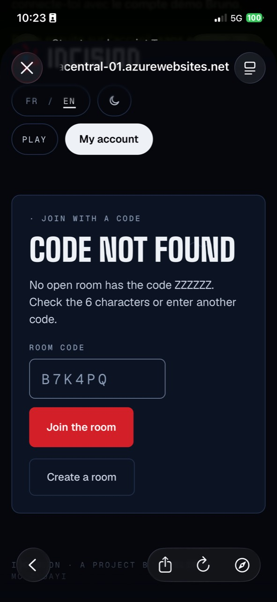

# SALLE-10 — contrôle Azure du 20 novembre 2026

Test borné autorisé par Philippe, sans modification de configuration, de base ou de déploiement. `/api/health/live` répond HTTP 200 avec le commit `276c06f4bfe2e6a081429ca9179f487dbb3f7778`; déploiement GitHub Actions 44835346332 réussi.

Deux sessions de démonstration Alice et Bruno ouvertes par l'authentification normale. Aucun cookie forgé, secret ou cookie conservé ici. Au plus 13 lectures séquentielles de `/rooms/ZZZZZZ` par série, code constaté inconnu; aucun balayage ni test de charge.

## Résultats (heure de Montréal)

| Série | Heure | Observation |
|---|---|---|
| Première | 22:16:33–22:16:35 | Essais 1 à 10 : « Code introuvable »; essai 11 : « Trop d’essais ». |
| Première | 22:16:35 | Refus maintenu avec `X-Forwarded-For: 198.51.100.200` et `x-incision-client-address: 203.0.113.200`, puis pour Bruno sur le même réseau. Ces valeurs sont des adresses de test. |
| Seconde | 22:22:35–22:22:37 | Dix réponses « Code introuvable », puis blocage, refus avec en-têtes forgés et refus pour le second compte. Le premier budget avait donc expiré. |
| Téléphone | 22:23 selon la capture | Philippe, connecté avec Bruno, Wi-Fi désactivé et données cellulaires actives, ouvre le lien au signal et confirme le succès : « CODE NOT FOUND » pour ZZZZZZ. La barre système affiche 5G. |

Les lectures automatisées répondent HTTP 200 : le refus est porté par la page, pas par HTTP 429.

Capture originale de Philippe, copiée sans retouche. B7K4PQ est l'exemple du champ; le message de réponse identifie bien ZZZZZZ.

## Portée

Seuil, partage entre comptes du réseau du Mac, refus des deux en-têtes forgés et indépendance du réseau cellulaire validés dans ce scénario. La fenêtre annoncée se terminait à 22:23:35 : la capture n'affiche pas les secondes, sa simultanéité repose aussi sur la confirmation humaine au signal.

La récupération est observée entre les séries, pas chronométrée à exactement 60 secondes. Les deux sessions automatisées ne représentent pas deux appareils physiques. Aucun relevé des paramètres App Service ni des IP réelles n'est revendiqué. Les tests locaux restent complémentaires pour la fenêtre glissante et les cas limites.

Conclusion : SALLE-10 complet dans le périmètre de l'énoncé et de cette recette. Aucun changement aux accents, aux bonus ou au texte IA.
